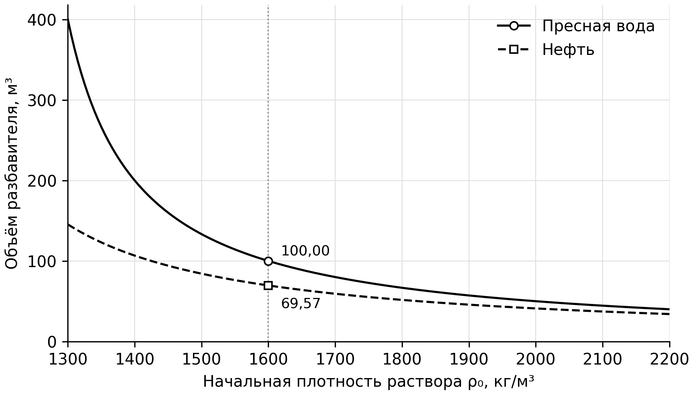

Российский государственный университет нефти и газа\
(национальный исследовательский университет) имени И. М. Губкина

Кафедра бурения нефтяных и газовых скважин

**РЕФЕРАТ**

по дисциплине «Промывка скважин и буровые растворы»

**«Расчёты при измерении плотности бурового раствора»**

Вариант № 7

Выполнил(а) — [ФИО студента]\
Группа РТ-23-12

Проверил — В. П. Зозуля

Москва, 2026

# Содержание

- Введение
- 1\. Теоретические основы определения плотности буровых растворов
  - 1\.1. Плотность бурового раствора и её технологическое значение
  - 1\.2. Методы и приборы измерения плотности
  - 1\.3. Материалы и способы регулирования плотности
  - 1\.4. Материальный баланс при изменении состава раствора
- 2\. Расчётная часть. Вариант № 7
  - 2\.1. Расчёт утяжеления бурового раствора оксидом железа и баритом
  - 2\.2. Определение плотности бентонитового бурового раствора
  - 2\.3. Расчёт снижения плотности бурового раствора водой и нефтью
- 3\. Анализ полученных результатов
- Заключение
- Список использованных источников

# Введение

Плотность бурового раствора определяет, какое гидростатическое давление создаёт столб жидкости над вскрытым пластом. При недостаточном давлении в скважину могут поступить пластовые флюиды, а при превышении давления начала поглощения раствор может уходить в пласт [1, с. 4 PDF] [2, с. 5 PDF].

Плотность пробы измеряют ареометром, рычажными весами или пикнометром. Измеренное значение сопоставляют с требуемым и используют как исходное при расчёте корректировки состава. Добавление утяжелителя или разбавителя изменяет и массу, и объём раствора. Материальный баланс позволяет рассчитать количество добавки с учётом обоих изменений. Повторное измерение после смешения показывает, достигнута ли заданная плотность [1, с. 10–13 PDF] [2, с. 109–111, 471–472 PDF].

Цель работы — объяснить, как измеряют и регулируют плотность бурового раствора, и решить три задачи варианта № 7 на основе материального баланса [1, с. 43 PDF].

В первой задаче сравниваются массы искусственного оксида железа Fe₂O₃ и барита BaSO₄, необходимые для утяжеления, и соответствующие приросты объёма. Во второй по заданной массовой доле бентонита определяются плотность водной суспензии и объёмная доля бентонита. В третьей сравниваются объёмы воды и нефти, необходимые для заданного снижения плотности, и определяется итоговая объёмная доля нефти [1, с. 43 PDF].

# 1. Теоретические основы определения плотности буровых растворов

## 1.1. Плотность бурового раствора и её технологическое значение

Плотность бурового раствора $\rho$ показывает, какая масса приходится на единицу его объёма. Если масса пробы равна $m$, а её объём равен $V$, то [2, с. 109 PDF]

$$
\rho=\frac{m}{V}.\qquad (1)
$$

В СИ массу выражают в килограммах, объём в кубических метрах, плотность в килограммах на кубический метр. При переводе показаний приборов используют соотношение 1 г/см³ = 1000 кг/м³ [2, с. 109–110 PDF].

Для неподвижного столба раствора постоянной плотности гидростатический вклад в давление $\Delta p$ определяют по зависимости [1, с. 4 PDF, формула (2)]

$$
\Delta p=\rho gH,\qquad (2)
$$

где $\Delta p$ измеряют в паскалях, $g$ — ускорение свободного падения, м/с², $H$ — вертикальная высота столба, м. В наклонной скважине $H$ определяют по разности высотных отметок уровня жидкости и точки расчёта.

Давление ниже пластового допускает приток газа, нефти или воды в скважину. При превышении давления начала поглощения раствор уходит в пласт. Верхнюю границу давления также ограничивает возможность гидроразрыва. При циркуляции сопротивление восходящему потоку в кольцевом пространстве увеличивает давление на стенки и забой, поэтому при выборе плотности учитывают режим циркуляции [1, с. 4–5 PDF] [2, с. 516 PDF].

## 1.2. Методы и приборы измерения плотности

АБР-1 определяет плотность по глубине погружения. При одинаковом объёме пробы более плотный раствор увеличивает массу прибора, поэтому поплавок вытесняет больше воды и погружается глубже. Мерный стакан заполняют пробой, соединяют с поплавком и обмывают снаружи. Прибор погружают в воду и считывают $\rho_\mathrm{осн}$ на основной шкале стержня по уровню воды. Стержень имеет также поправочную шкалу [2, с. 109 PDF].

Если для погружения используют минерализованную воду, её плотность влияет на глубину погружения. Для определения поправки стакан заполняют той же водой, опускают прибор в ёмкость и считывают $\Delta\rho_\mathrm{попр}$ по поправочной шкале. Эту величину прибавляют к основному отсчёту с её алгебраическим знаком [2, с. 109 PDF, формула (1)]

$$
\rho=\rho_\mathrm{осн}+\Delta\rho_\mathrm{попр}.
$$

Контрольное показание при калибровке чистой пресной водой при $(20\pm5)$ °C составляет 1 г/см³. На рисунке 1 указаны шкалы, уровень отсчёта и съёмный груз [2, с. 109–110 PDF].

![Рисунок 1 — Устройство ареометра АБР-1 (составлено по [2, с. 109–110 PDF])](../реферат/иллюстрации/АБР-1.png){width=85%}

У рычажных весов пробой заполняют чашку постоянного объёма. Избыток выходит через отверстие в крышке. После очистки чашки снаружи рейтер перемещают по градуированному рычагу до равновесия по встроенному уровню. Плотность считывают у края рейтера. При калибровке используют пресную воду с известной плотностью [2, с. 110–111 PDF].

Пикнометр представляет собой сосуд известной вместимости $V_\mathrm{пик}$. Для определения плотности взвешивают чистый сухой сосуд и сосуд, заполненный пробой. Пусть $m_\mathrm{пуст}$ и $m_\mathrm{зап}$ — показания весов соответственно [2, с. 111 PDF, формула (2)].

$$
\rho=\frac{m_\mathrm{зап}-m_\mathrm{пуст}}{V_\mathrm{пик}}.
$$

Для воспроизводимого отсчёта отбирают представительную пробу перемешанного раствора, соблюдают условия калибровки, полностью заполняют мерную посуду и очищают её снаружи. Если часть мерного объёма занята пузырьками газа, отсчёт будет ниже плотности дегазированного раствора [2, с. 109–111 PDF].

## 1.3. Материалы и способы регулирования плотности

Для утяжеления в раствор вводят мелкоизмельчённый твёрдый материал большей плотности. Объём добавки в балансе определяют по плотности частиц, поскольку жидкость заполняет промежутки между ними. При выборе материала учитывают также его химическую инертность, размер частиц и абразивность [1, с. 7–8, 10–11 PDF].

Искусственный оксид железа Fe₂O₃ в таблице пособия приведён отдельно от гематита. Его расчётная плотность составляет 4700 кг/м³. Барит BaSO₄ практически нерастворим в воде, его табличная плотность составляет 4200–4500 кг/м³. В задаче для сравнения используют 4250 кг/м³ по методике пособия [1, с. 7–8, 11 PDF] [2, с. 189 PDF].

Для снижения плотности к раствору добавляют менее плотную жидкость. В расчёте пресная вода и нефть служат альтернативными разбавителями. Выбор жидкости зависит от состава исходного раствора и требований к свойствам готовой смеси [1, с. 12–13, 43 PDF].

Бентонит служит глинистым компонентом водной суспензии. В его составе преобладает монтмориллонит, который при взаимодействии с водой гидратируется и набухает. Бентонит влияет на реологические свойства раствора, способствует выносу шлама и снижает фильтрацию воды в проницаемые породы [2, с. 82–83, 191, 193 PDF].

## 1.4. Материальный баланс при изменении состава раствора

При смешивании без потерь складываются массы всех компонентов. Для компонента $i$ масса $m_i$ связана с объёмом $V_i$ и плотностью $\rho_i$ по формуле (1). Принимаем, что смесь однородна, расчётные плотности постоянны, а объёмы аддитивны. Тогда для смеси объёмом $V$ и плотностью $\rho$ получаем [1, с. 10 PDF, формулы (9)–(11)] [2, с. 471–472 PDF]

$$
\rho V=\sum_i m_i=\sum_i\rho_i V_i,\qquad V=\sum_i V_i.\qquad (3)
$$

В модели (3) плотность смеси равна среднему плотностей компонентов, взвешенному по объёмам. Для двух компонентов разной плотности и положительных объёмов плотность смеси лежит строго между плотностями компонентов. Это условие определяет, достижима ли целевая плотность при выбранной добавке.

Аддитивность объёмов является расчётным допущением. При гидратации бентонита часть воды связывается глинистыми частицами и её удельный объём может меняться. Поэтому объём реальной суспензии после приготовления может отличаться от суммы исходных объёмов [1, с. 10, 12 PDF] [2, с. 82–83 PDF].

Массовую долю $w_i$ находят по отношению массы компонента к полной массе смеси $m$, а объёмную долю $\varphi_i$ — по отношению объёма компонента к полному объёму смеси $V$.

$$
w_i=\frac{m_i}{m},\qquad \varphi_i=\frac{V_i}{V}.\qquad (4)
$$

Обе доли принимают значения от нуля до единицы и могут выражаться в процентах. При утяжелении и разбавлении исходный раствор входит в баланс как один компонент. Его массу вычисляют по начальной плотности и объёму партии [1, с. 10–13 PDF].

# 2. Расчётная часть. Вариант № 7

## 2.1. Расчёт утяжеления бурового раствора оксидом железа и баритом

В варианте № 7 требуется повысить плотность бурового раствора с $\rho_0=1350$ до $\rho_\mathrm{к}=1600$ кг/м³ при начальном объёме $V_0=100$ м³. Определим требуемые массы искусственного оксида железа Fe₂O₃ и барита BaSO₄, а также прирост объёма раствора при использовании каждого утяжелителя [1, с. 43 PDF, задание 1 и строка 7].

Для искусственного оксида железа берём плотность $\rho_\mathrm{Fe}=4700$ кг/м³ из одноимённой строки табл. 1 пособия, где гематит приведён отдельно. Плотность барита $\rho_\mathrm{бар}=4250$ кг/м³ принимаем по пояснению к формуле (17) пособия. Эти значения характеризуют материал частиц и нужны для связи массы и объёма добавки [1, с. 8 PDF, табл. 1, с. 11 PDF].

Каждый сухой нерастворимый утяжелитель добавляем к отдельной партии при одинаковых $V_0$ и $\rho_0$. Считаем смесь однородной, плотности постоянными, а объёмы аддитивными. Весь исходный раствор сохраняется, потерь при смешении нет. Индексы $0$, $\mathrm{к}$ и $\mathrm{у}$ обозначают исходный раствор, конечную смесь и утяжелитель соответственно. По балансу из § 1.4 конечная масса $m_\mathrm{к}=m_0+m_\mathrm{у}$, а конечный объём $V_\mathrm{к}=V_0+V_\mathrm{у}$. Поэтому объём частиц $V_\mathrm{у}$ равен приросту $\Delta V=V_\mathrm{к}-V_0$ [1, с. 10–11 PDF, формулы (9)–(11), (20)].

Подстановка связи $m=\rho V$ в баланс массы даёт $\rho_\mathrm{к}(V_0+V_\mathrm{у})=\rho_0V_0+\rho_\mathrm{у}V_\mathrm{у}$. Переносим слагаемые с $V_\mathrm{у}$ в одну часть, а с $V_0$ в другую. При $\rho_0<\rho_\mathrm{к}<\rho_\mathrm{у}$ получаем положительный прирост объёма и массу добавки [1, с. 11 PDF, формулы (21)–(22)].

$$
\Delta V=V_\mathrm{у}=\frac{V_0(\rho_\mathrm{к}-\rho_0)}{\rho_\mathrm{у}-\rho_\mathrm{к}}.\qquad (5)
$$

$$
m_\mathrm{у}=\rho_\mathrm{у}\Delta V=\frac{V_0\rho_\mathrm{у}(\rho_\mathrm{к}-\rho_0)}{\rho_\mathrm{у}-\rho_\mathrm{к}}.\qquad (6)
$$

Для каждой партии $m_0=(1350\,\text{кг}/\text{м}^3)(100\,\text{м}^3)=135\,000\,\text{кг}$. Заданное увеличение плотности равно $(1600-1350)\,\text{кг}/\text{м}^3=250\,\text{кг}/\text{м}^3$.

Для искусственного оксида железа формулы (5) и (6) дают

$$
\begin{aligned}
\Delta V_\mathrm{Fe}&=(100\,\text{м}^3)\frac{250\,\text{кг}/\text{м}^3}{(4700-1600)\,\text{кг}/\text{м}^3}=\frac{250}{31}\,\text{м}^3,\\
m_\mathrm{Fe}&=(4700\,\text{кг}/\text{м}^3)\left(\frac{250}{31}\,\text{м}^3\right)=\frac{1\,175\,000}{31}\,\text{кг}.
\end{aligned}
$$

Конечный объём равен $(100+250/31)\,\text{м}^3=(3350/31)\,\text{м}^3$, а конечная масса равна $(135\,000+1\,175\,000/31)\,\text{кг}=(5\,360\,000/31)\,\text{кг}$.

Для барита по тем же формулам получаем

$$
\begin{aligned}
\Delta V_\mathrm{бар}&=(100\,\text{м}^3)\frac{250\,\text{кг}/\text{м}^3}{(4250-1600)\,\text{кг}/\text{м}^3}=\frac{500}{53}\,\text{м}^3,\\
m_\mathrm{бар}&=(4250\,\text{кг}/\text{м}^3)\left(\frac{500}{53}\,\text{м}^3\right)=\frac{2\,125\,000}{53}\,\text{кг}.
\end{aligned}
$$

Конечный объём равен $(100+500/53)\,\text{м}^3=(5800/53)\,\text{м}^3$, а конечная масса равна $(135\,000+2\,125\,000/53)\,\text{кг}=(9\,280\,000/53)\,\text{кг}$.

В таблице 1 сопоставлены массы добавок, приросты объёма и параметры обеих смесей после утяжеления.

Таблица 1 — Результаты расчёта утяжеления

| Показатель | Искусственный оксид железа | Барит |
| --- | ---: | ---: |
| Масса утяжелителя, кг | 37 903,23 | 40 094,34 |
| Прирост объёма, м³ | 8,06 | 9,43 |
| Конечный объём, м³ | 108,06 | 109,43 |
| Конечная масса, кг | 172 903,23 | 175 094,34 |
| Конечная плотность, кг/м³ | 1 600,00 | 1 600,00 |

Разности считаем до округления. Для массы разность $m_\mathrm{бар}-m_\mathrm{Fe}=(3\,600\,000/1643)\,\text{кг}\approx2\,191{,}11\,\text{кг}$. Для прироста объёма разность $\Delta V_\mathrm{бар}-\Delta V_\mathrm{Fe}=(2250/1643)\,\text{м}^3\approx1{,}37\,\text{м}^3$. Относительные разности получаем делением на массу барита и прирост с баритом соответственно.

$$
\frac{m_\mathrm{бар}-m_\mathrm{Fe}}{m_\mathrm{бар}}=\frac{144}{2635}\approx5{,}46\,\%,
\qquad \frac{\Delta V_\mathrm{бар}-\Delta V_\mathrm{Fe}}{\Delta V_\mathrm{бар}}=\frac{9}{62}\approx14{,}52\,\%.
$$

Обратная проверка по точным значениям возвращает целевую плотность для обеих смесей.

$$
\frac{5\,360\,000/31}{3350/31}\,\frac{\text{кг}}{\text{м}^3}
=\frac{9\,280\,000/53}{5800/53}\,\frac{\text{кг}}{\text{м}^3}
=1600\,\frac{\text{кг}}{\text{м}^3}.
$$

При принятых плотностях материалов искусственный оксид железа обеспечивает заданное утяжеление при меньшей массе добавки и меньшем приросте объёма. Его плотность выше, поэтому один кубометр добавки обеспечивает больший прирост массы относительно массы того же объёма смеси при целевой плотности, как видно из знаменателя формулы (5).

## 2.2. Определение плотности бентонитового бурового раствора

Требуется определить плотность бурового раствора на водной основе. Содержание бентонита по условию равно номеру варианта в массовых процентах, то есть 7 % по массе ($w_\mathrm{б}=0{,}07$). Плотность бентонита $\rho_\mathrm{б}=2500$ кг/м³ также задана. Как в примере 2 пособия, принимаем плотность пресной воды $\rho_\mathrm{в}=1000$ кг/м³ и за основу расчёта берём 100 кг готовой смеси. Такая основа позволяет сразу перевести массовую долю в массу бентонита [1, с. 43 PDF, задание 2, с. 12 PDF, пример 2].

Рассматриваем однородную суспензию из двух компонентов с заданными плотностями. Индексы $\mathrm{б}$ и $\mathrm{в}$ относятся к сухому бентониту и пресной воде. Принимаем смешение без потерь и аддитивное сложение объёмов, пренебрегая изменением общего объёма при гидратации бентонита. Из массового баланса $m=m_\mathrm{б}+m_\mathrm{в}$ и определения массовой доли получаем $m_\mathrm{б}=w_\mathrm{б}m$, $m_\mathrm{в}=(1-w_\mathrm{б})m$. Объём каждого компонента равен его массе, делённой на плотность. Поэтому $V=V_\mathrm{б}+V_\mathrm{в}=m_\mathrm{б}/\rho_\mathrm{б}+m_\mathrm{в}/\rho_\mathrm{в}$ [1, с. 12 PDF, пример 2, с. 14 PDF, формулы (29), (30′)].

Подставляя массы компонентов в выражение для объёма и сокращая общую массу, получаем плотность смеси.

$$
\rho=\frac{m}{V}=\left(\frac{w_\mathrm{б}}{\rho_\mathrm{б}}+\frac{1-w_\mathrm{б}}{\rho_\mathrm{в}}\right)^{-1}.\qquad (7)
$$

Для принятой массы $m=100\,\text{кг}$ массы бентонита и воды равны $m_\mathrm{б}=0{,}07\cdot 100\,\text{кг}=7\,\text{кг}$ и $m_\mathrm{в}=0{,}93\cdot 100\,\text{кг}=93\,\text{кг}$. Вычисляем объёмы компонентов и суммарный объём.

$$
\begin{aligned}
V_\mathrm{б}&=\frac{7\,\text{кг}}{2500\,\text{кг}/\text{м}^3}=0{,}0028\,\text{м}^3,\\
V_\mathrm{в}&=\frac{93\,\text{кг}}{1000\,\text{кг}/\text{м}^3}=0{,}0930\,\text{м}^3,\\
V&=(0{,}0028+0{,}0930)\,\text{м}^3=\frac{479}{5000}\,\text{м}^3=0{,}0958\,\text{м}^3.
\end{aligned}
$$

Таблица 2 показывает вклад воды и бентонита в массу и объём готовой смеси.

Таблица 2 — Масса и объём компонентов бентонитового раствора

| Компонент | Масса, кг | Объём, м³ |
| --- | ---: | ---: |
| Бентонит | 7,00 | 0,0028 |
| Пресная вода | 93,00 | 0,0930 |
| Готовая смесь | 100,00 | 0,0958 |

Из отношения общей массы к объёму по формуле (7) получаем расчётную плотность.

$$
\rho=\frac{100\,\text{кг}}{0{,}0958\,\text{м}^3}
=\frac{500\,000}{479}\,\frac{\text{кг}}{\text{м}^3}
\approx 1\,043{,}84\,\frac{\text{кг}}{\text{м}^3}.
$$

Объёмную долю бентонита $\varphi_\mathrm{б}$ определяем отдельно. Отношение $V_\mathrm{б}/V=(0{,}0028\,\text{м}^3)/(0{,}0958\,\text{м}^3)=14/479$ после перевода в проценты даёт 2,92 % об.

Обратная проверка по точной плотности и суммарному объёму даёт $\rho V=(500\,000/479)\cdot(479/5000)\,\text{кг}=100\,\text{кг}$.

Расчётная плотность суспензии лежит между плотностями воды и бентонита. Бентонит занимает меньший объём на единицу массы, чем пресная вода, поэтому его объёмная доля меньше массовой.

## 2.3. Расчёт снижения плотности бурового раствора водой и нефтью

Для снижения риска поглощения требуется уменьшить плотность утяжелённого бурового раствора на $\Delta\rho=200$ кг/м³. Для исходного объёма $V_0=200$ м³ нужно определить требуемый объём воды или нефти и объёмное нефтесодержание готовой смеси. Плотность нефти $\rho_\mathrm{н}=825$ кг/м³ задана в условии, а плотность пресной воды $\rho_\mathrm{в}=1000$ кг/м³ принимаем по методике пособия. Начальная плотность всего раствора $\rho_0$ и начальная объёмная доля нефти $\varphi_0$ в условии отсутствуют, поэтому сохраняем их как параметры [1, с. 43 PDF, задание 3, с. 12–13 PDF, формула (26)].

Пресную воду и нефть рассматриваем как две самостоятельные альтернативы. В каждой исходный раствор сохраняется полностью, а однородная смесь образуется без потерь. Считаем плотности постоянными, объёмы аддитивными. Индексы $0$, $\mathrm{к}$ и $\mathrm{д}$ относятся к исходному раствору, конечной смеси и разбавителю, а индексы $\mathrm{в}$ и $\mathrm{н}$ относятся к воде и нефти соответственно. Из балансов $m_\mathrm{к}=\rho_0V_0+\rho_\mathrm{д}V_\mathrm{д}$ и $V_\mathrm{к}=V_0+V_\mathrm{д}$ следует $\rho_\mathrm{к}(V_0+V_\mathrm{д})=\rho_0V_0+\rho_\mathrm{д}V_\mathrm{д}$. Собираем слагаемые с объёмом добавки в одной части равенства и подставляем $\rho_\mathrm{к}=\rho_0-\Delta\rho$ [1, с. 12–13 PDF, формулы (25)–(27), с. 40 PDF, формулы (99), (102)].

$$
V_\mathrm{д}=\frac{V_0\Delta\rho}{\rho_\mathrm{к}-\rho_\mathrm{д}}
=\frac{V_0\Delta\rho}{\rho_0-\Delta\rho-\rho_\mathrm{д}}.\qquad (8)
$$

Произведение $V_0\Delta\rho=(200\,\text{м}^3)(200\,\text{кг}/\text{м}^3)=40\,000\,\text{кг}$ одинаково для двух альтернатив. С учётом плотности каждого разбавителя получаем

$$
V_\mathrm{в}=\frac{40\,000\,\text{кг}}{\rho_0-1200\,\text{кг}/\text{м}^3},
\qquad V_\mathrm{н}=\frac{40\,000\,\text{кг}}{\rho_0-1025\,\text{кг}/\text{м}^3}.
$$

Для каждого разбавителя массу добавки определяем как $m_\mathrm{д}=\rho_\mathrm{д}V_\mathrm{д}$. Конечные объём и масса равны $V_\mathrm{к}=V_0+V_\mathrm{д}$ и $m_\mathrm{к}=m_0+m_\mathrm{д}$, где $m_0=\rho_0V_0$.

В исходной партии содержится $\varphi_0 V_0$ нефти. Вода сохраняет этот объём нефти, а добавление нефти увеличивает его на $V_\mathrm{н}$. Для исходной и добавленной нефти принимаем одинаковую плотность. Обозначим верхними индексами $(\mathrm{в})$ и $(\mathrm{н})$ результаты разбавления водой и нефтью. Делим объём всей нефти на конечный объём каждой смеси. Та же база используется в примере 3 пособия при расчёте доли добавленной нефти [1, с. 13 PDF, формула (28) и пример 3].

$$
\varphi_\mathrm{к}^{(\mathrm{в})}=\frac{\varphi_0V_0}{V_0+V_\mathrm{в}},
\qquad \varphi_\mathrm{к}^{(\mathrm{н})}=\frac{\varphi_0V_0+V_\mathrm{н}}{V_0+V_\mathrm{н}}.\qquad (9)
$$

Чтобы выразить долю в объёмных процентах, умножаем её на 100. Для исходного утяжелённого раствора требуется $0\le\varphi_0<1$ и положительная масса остальных компонентов, то есть $\rho_0>\rho_\mathrm{н}\varphi_0$.

Конечный положительный объём добавки по формуле (8) возможен при $\rho_\mathrm{д}<\rho_\mathrm{к}<\rho_0$. Обе альтернативы достижимы при $\rho_0>1200$ кг/м³. В диапазоне $1025<\rho_0\le1200$ кг/м³ заданное снижение достижимо только с нефтью, а при $\rho_0\le1025$ кг/м³ недостижимо с обоими разбавителями. При приближении к порогу данного разбавителя сверху требуемый объём неограниченно возрастает.

**Условный численный сценарий**

Для отдельной исходной партии объёмом 200 м³ принимаем $\rho_0=1600$ кг/м³ по конечной плотности задания 1 и $\varphi_0=0$ (0 % об. исходной нефти). Требуемое снижение даёт $\rho_\mathrm{к}=(1600-200)\,\text{кг}/\text{м}^3=1400\,\text{кг}/\text{м}^3$. Начальная масса составляет $m_0=(1600\,\text{кг}/\text{м}^3)(200\,\text{м}^3)=320\,000\,\text{кг}$.

При разбавлении водой по формуле (8) получаем

$$
\begin{aligned}
V_\mathrm{в}&=\frac{40\,000\,\text{кг}}{(1400-1000)\,\text{кг}/\text{м}^3}=100\,\text{м}^3,\\
m_\mathrm{в}&=(1000\,\text{кг}/\text{м}^3)(100\,\text{м}^3)=100\,000\,\text{кг}.
\end{aligned}
$$

Конечный объём равен $(200+100)\,\text{м}^3=300\,\text{м}^3$, а конечная масса $(320\,000+100\,000)\,\text{кг}=420\,000\,\text{кг}$. По формуле (9) $\varphi_\mathrm{к}^{(\mathrm{в})}=0$.

При разбавлении нефтью получаем

$$
\begin{aligned}
V_\mathrm{н}&=\frac{40\,000\,\text{кг}}{(1400-825)\,\text{кг}/\text{м}^3}=\frac{1600}{23}\,\text{м}^3,\\
m_\mathrm{н}&=(825\,\text{кг}/\text{м}^3)\left(\frac{1600}{23}\,\text{м}^3\right)=\frac{1\,320\,000}{23}\,\text{кг}.
\end{aligned}
$$

Конечный объём равен $(200+1600/23)\,\text{м}^3=(6200/23)\,\text{м}^3$, а конечная масса $(320\,000+1\,320\,000/23)\,\text{кг}=(8\,680\,000/23)\,\text{кг}$. По формуле (9) $\varphi_\mathrm{к}^{(\mathrm{н})}=(1600/23)/(6200/23)=8/31$, то есть 25,81 % об.

В таблице 3 приведены количества разбавителей и параметры смеси для условного сценария.

Таблица 3 — Результаты разбавления в условном сценарии

| Показатель | Пресная вода | Нефть |
| --- | ---: | ---: |
| Объём разбавителя, м³ | 100,00 | 69,57 |
| Масса разбавителя, кг | 100 000,00 | 57 391,30 |
| Конечный объём, м³ | 300,00 | 269,57 |
| Конечная масса, кг | 420 000,00 | 377 391,30 |
| Конечная плотность, кг/м³ | 1 400,00 | 1 400,00 |
| Суммарная объёмная доля нефти, % об. | 0,00 | 25,81 |

Обратная проверка по точным значениям конечных массы и объёма даёт требуемую плотность для обоих разбавителей.

$$
\frac{420\,000}{300}\,\frac{\text{кг}}{\text{м}^3}
=\frac{8\,680\,000/23}{6200/23}\,\frac{\text{кг}}{\text{м}^3}
=1400\,\frac{\text{кг}}{\text{м}^3}.
$$

В условном сценарии нефти требуется на $(100-1600/23)\,\text{м}^3=(700/23)\,\text{м}^3\approx30{,}43\,\text{м}^3$ меньше, или на 30,43 % от объёма воды. При равном снижении плотности меньшая плотность разбавителя увеличивает знаменатель в формуле (8) и уменьшает объём добавки. Для оценки предотвращения поглощения потребуются фактическое давление при заданном режиме циркуляции и давление начала поглощения.

# 3. Анализ полученных результатов

В § 2.1 разность $\rho_\mathrm{у}-\rho_\mathrm{к}$ у искусственного оксида железа Fe₂O₃ больше, чем у барита BaSO₄. Каждый кубометр оксида даёт больший избыток массы над массой равного объёма смеси целевой плотности. Доля этого избытка в массе добавки также выше. Поэтому расчётная масса оксида меньше на 2 191,11 кг (5,46 % от массы барита), а прирост объёма — на 1,37 м³ (14,52 % от прироста с баритом) [1, с. 8, 11 PDF].

В § 2.2 на бентонит приходится 7 % массы и 2,92 % объёма. При равной массе более плотный бентонит занимает меньший объём, чем вода. Объёмная доля рассчитана по плотности сухого материала при аддитивности объёмов. При гидратации глина набухает [1, с. 12, 43 PDF] [2, с. 82–83 PDF].

В условном сценарии § 2.3 нефти требуется на 30,43 % меньше по объёму, чем воды. Менее плотная нефть даёт большую разность $\rho_\mathrm{к}-\rho_\mathrm{д}$. При нулевом исходном нефтесодержании добавленная нефть составляет 25,81 % об. конечной смеси [1, с. 12–13, 40 PDF].

На рисунке 2 обе кривые убывают. При заданном снижении рост начальной плотности увеличивает целевую плотность и её разность с плотностью добавки.

{width=85%}

При приближении сверху к порогам 1200 кг/м³ для воды и 1025 кг/м³ для нефти потребный объём растёт неограниченно. На пороге целевая плотность равна плотности разбавителя и достижима лишь в пределе. Ниже порога требуемое снижение недостижимо [1, с. 12–13 PDF].

Баланс предполагает однородное смешение, постоянные плотности, аддитивность объёмов и сохранение всей исходной партии. При подборе утяжелителя учитывают стоимость и доступность [1, с. 8 PDF], при подборе разбавителя — совместимость с раствором. При постоянной вертикальной высоте столба $H$ снижение плотности уменьшает гидростатический вклад на $gH\Delta\rho$. Для оценки поглощения нужны вертикальная глубина, фактическое давление при циркуляции и давление начала поглощения [1, с. 4–5 PDF] [2, с. 516 PDF].

# Заключение

Измеренная плотность нужна для оценки гидростатического давления и корректировки состава. Три задачи варианта № 7 решены по балансу массы при аддитивных объёмах (§§ 1.1–1.4).

Для утяжеления 100 м³ раствора с 1350 до 1600 кг/м³ требуется 37 903,23 кг искусственного оксида железа Fe₂O₃ или 40 094,34 кг барита BaSO₄. Прирост объёма составляет 8,06 и 9,43 м³ соответственно. Меньший расход оксида обусловлен его большей плотностью (§ 2.1).

Плотность водной суспензии с 7 % бентонита по массе составляет 1 043,84 кг/м³. На бентонит приходится 2,92 % об., поскольку при равной массе он занимает меньший объём, чем вода (§ 2.2).

В параметрическом решении задачи № 3 объёмы разбавителей зависят от начальной плотности, а итоговое нефтесодержание — также от исходной доли нефти. Оба параметра в условии остаются открытыми [1, с. 43 PDF]. Для отдельной партии 200 м³ при условных 1600 кг/м³ и 0 % об. исходной нефти снижение плотности до 1400 кг/м³ требует 100,00 м³ воды или 69,57 м³ менее плотной нефти. При добавлении нефти её доля составляет 25,81 % об. (§ 2.3).

Модель предполагает однородность смеси, постоянство плотностей компонентов и отсутствие потерь. При выборе добавки учитывают свойства готового раствора. Оценка риска поглощения требует сопоставления давления в скважине при заданном режиме циркуляции с давлением начала поглощения (гл. 3).

# Список использованных источников

[1] Зозуля В. П., Ангелопуло О. К., Зозуля Н. Е., Головин В. В. Расчеты при измерении плотности бурового раствора. Учебное пособие. Москва, РГУ нефти и газа имени И. М. Губкина, 2026.

[2] Конспект лекций по дисциплине «Промывка скважин и буровые растворы». Преподаватель В. П. Зозуля. РГУ нефти и газа (НИУ) имени И. М. Губкина, кафедра бурения нефтяных и газовых скважин. Москва, 2026.
