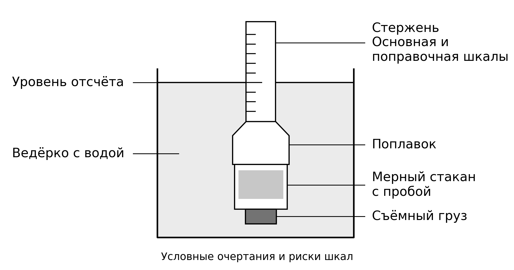

Российский государственный университет нефти и газа\
(национальный исследовательский университет) имени И. М. Губкина

Кафедра бурения нефтяных и газовых скважин

**РЕФЕРАТ**

по дисциплине «Промывка скважин и буровые растворы»

**«Расчёты при измерении плотности бурового раствора»**

Вариант № 7

Выполнил(а) - ФИО ____________________\
Группа РТ-23-12

Проверил - В. П. Зозуля

Москва, 2026

# Содержание

- Введение
- 1\. Теоретические основы определения плотности буровых растворов
  - 1\.1. Плотность бурового раствора и её технологическое значение
  - 1\.2. Методы и приборы измерения плотности
  - 1\.3. Материалы и способы регулирования плотности
  - 1\.4. Материальный баланс при изменении состава раствора
- 2\. Расчётная часть. Вариант № 7
  - 2\.1. Расчёт утяжеления бурового раствора оксидом железа и баритом
  - 2\.2. Определение плотности бентонитового бурового раствора
  - 2\.3. Расчёт снижения плотности бурового раствора водой и нефтью
- 3\. Анализ полученных результатов
- Заключение
- Список литературы

# Введение

Плотность бурового раствора определяет, какое гидростатическое давление создаёт столб жидкости над вскрытым пластом. При недостаточном давлении в скважину могут поступить пластовые флюиды, а при превышении давления начала поглощения раствор может уходить в пласт.

Плотность пробы измеряют ареометром, рычажными весами или пикнометром. По результату измерения и заданной плотности рассчитывают, сколько утяжелителя или разбавителя нужно добавить. Материальный баланс учитывает, что при добавлении меняются и масса, и объём раствора. После смешивания плотность измеряют повторно.

Цель работы - объяснить, как измеряют и регулируют плотность бурового раствора, и решить три задачи варианта № 7 на основе материального баланса.

В первой задаче сравниваются массы искусственного оксида железа Fe₂O₃ и барита BaSO₄, необходимые для утяжеления, и соответствующие приросты объёма. Во второй по заданной массовой доле бентонита определяются плотность водной суспензии и объёмная доля бентонита. В третьей сравниваются объёмы воды и нефти, необходимые для заданного снижения плотности, и определяется итоговая объёмная доля нефти.

# 1. Теоретические основы определения плотности буровых растворов

## 1.1. Плотность бурового раствора и её технологическое значение

Плотность бурового раствора $\rho$ равна отношению массы пробы $m$ к её объёму $V$.

$$
\rho=\frac{m}{V}.\qquad (1)
$$

В СИ массу выражают в килограммах, объём в кубических метрах, плотность в килограммах на кубический метр. При переводе показаний приборов используют соотношение 1 г/см³ = 1000 кг/м³.

Гидро&shy;статическое давление $\Delta p$ неподвижного столба раствора постоянной плотности определяют по формуле (2).

$$
\Delta p=\rho gH,\qquad (2)
$$

где $\Delta p$ измеряют в паскалях, $g$ - ускорение свободного падения, м/с², $H$ - вертикальная высота столба, м. В наклонной скважине $H$ определяют по разности высотных отметок уровня жидкости и точки расчёта.

Если давление в скважине ниже пластового, в неё могут поступить газ, нефть или вода. При превышении давления начала поглощения раствор уходит в пласт. Верхнюю границу давления также ограничивает возможность гидроразрыва. При циркуляции сопротивление восходящему потоку в кольцевом пространстве увеличивает давление на стенки и забой, поэтому при выборе плотности учитывают режим циркуляции.

## 1.2. Методы и приборы измерения плотности

АБР-1 определяет плотность по глубине погружения. При одинаковом объёме проб и неизменной плотности воды в ведёрке ареометр с более плотной пробой тяжелее. Он вытесняет больше воды и погружается глубже.

Мерный стакан вмещает $(78{,}5\pm1)$ см³ пробы. Заполненный стакан соединяют с поплавком поворотом до упора и обмывают снаружи. Прибор погружают в воду и слегка вращают, чтобы удалить приставшие пузырьки воздуха. Когда ареометр свободно плавает, по уровню воды на основной шкале считывают $\rho_\mathrm{осн}$. Съёмный груз крепится под стаканом (рис. 1). Диапазон измерений с грузом составляет 800-1700 кг/м³, без груза - 1700-2600 кг/м³.

Если для погружения используют минерализованную воду, её плотность влияет на глубину погружения. Для определения поправки стакан заполняют той же водой, опускают прибор в ёмкость и считывают $\Delta\rho_\mathrm{попр}$ по поправочной шкале. К показанию основной шкалы прибавляют поправку с учётом её знака. Обе величины выражают в одних единицах.

$$
\rho=\rho_\mathrm{осн}+\Delta\rho_\mathrm{попр}.
$$

Ареометр проверяют с установленным грузом на дистиллированной воде при температуре $(20\pm5)$ °C. Основная шкала должна показать 1 г/см³.

{width=85%}

Пробой заполняют мерную чашку рычажных весов. Избыток выходит через отверстие в крышке. Чашку очищают снаружи и перемещают рейтер по градуированному рычагу, пока встроенный уровень не покажет равновесие. Плотность считывают у края рейтера. При проверке чашку заполняют пресной водой и ставят рейтер на отметку 1 г/см³. Если рычаг отклоняется от равновесия, регулируют противовес.

Пикнометр представляет собой сосуд известной вместимости $V_\mathrm{пик}$. Для определения плотности взвешивают чистый сухой сосуд и сосуд, заполненный пробой. Пусть $m_\mathrm{пуст}$ и $m_\mathrm{зап}$ - показания весов соответственно.

$$
\rho=\frac{m_\mathrm{зап}-m_\mathrm{пуст}}{V_\mathrm{пик}}.
$$

Для воспроизводимого отсчёта отбирают представительную пробу перемешанного раствора, соблюдают условия калибровки, полностью заполняют мерную посуду и очищают её снаружи. Если часть мерного объёма занята пузырьками газа, отсчёт будет ниже плотности дегазиро&shy;ванного раствора.

## 1.3. Материалы и способы регулирования плотности

Для утяжеления в раствор вводят мелкоизмельчённый твёрдый материал большей плотности. Объём добавки в балансе определяют по плотности частиц, поскольку жидкость заполняет промежутки между ними. При выборе материала учитывают также его химическую инертность, размер частиц и абразивность.

Расчётная плотность искусственного оксида железа Fe₂O₃ составляет 4700 кг/м³. Барит BaSO₄ практически нерастворим в воде, его табличная плотность составляет 4200-4500 кг/м³. В задаче для сравнения используют 4250 кг/м³.

Для снижения плотности к раствору добавляют менее плотную жидкость. В расчёте пресная вода и нефть служат альтернативными разбавителями. Выбор жидкости зависит от состава исходного раствора и требований к свойствам готовой смеси.

Бентонит служит глинистым компонентом водной суспензии. В его составе преобладает монтмориллонит, который при взаимодействии с водой гидратируется и набухает. Бентонит влияет на реологические свойства раствора, способствует выносу шлама и снижает фильтрацию воды в проницаемые породы.

## 1.4. Материальный баланс при изменении состава раствора

При смешивании без потерь складываются массы всех компонентов. Для компонента $i$ масса $m_i$ связана с объёмом $V_i$ и плотностью $\rho_i$ по формуле (1). Во всех трёх расчётах считаем смесь однородной, плотности компонентов постоянными, а объём смеси равным сумме исходных объёмов. Тогда для смеси выполняется баланс (3).

$$
\rho V=\sum_i m_i=\sum_i\rho_i V_i,\qquad V=\sum_i V_i.\qquad (3)
$$

В модели (3) плотность смеси равна среднему плотностей компо&shy;нентов, взвешенному по объёмам. Для двух компонентов разной плотности и положительных объёмов плотность смеси лежит строго между плотностями компонентов. Это условие определяет, достижима ли целевая плотность при выбранной добавке.

При гидратации бентонита часть воды связывается глинистыми частицами и её удельный объём может меняться. Поэтому объём приготовленной суспензии может отличаться от суммы исходных объёмов.

Массовую долю $w_i$ находят по отношению массы компонента к полной массе смеси $m$, а объёмную долю $\varphi_i$ - по отношению объёма компонента к полному объёму смеси $V$.

$$
w_i=\frac{m_i}{m},\qquad \varphi_i=\frac{V_i}{V}.\qquad (4)
$$

Обе доли принимают значения от нуля до единицы и могут выражаться в процентах. При утяжелении и разбавлении исходный раствор входит в баланс как один компонент. Его массу вычисляют по начальной плотности и объёму партии.

# 2. Расчётная часть. Вариант № 7

## 2.1. Расчёт утяжеления бурового раствора оксидом железа и баритом

В варианте № 7 требуется повысить плотность бурового раствора с $\rho_0=1350$ до $\rho_\mathrm{к}=1600$ кг/м³ при начальном объёме $V_0=100$ м³. Определим требуемые массы искусственного оксида железа Fe₂O₃ и барита BaSO₄, а также прирост объёма раствора при использовании каждого утяжелителя.

В расчёте используем плотности частиц утяжелителей. Для искусственного оксида железа $\rho_\mathrm{Fe}=4700$ кг/м³, для барита $\rho_\mathrm{бар}=4250$ кг/м³.

Каждый сухой нерастворимый утяжелитель добавляем к отдельной партии при одинаковых $V_0$ и $\rho_0$. Индексы $0$, $\mathrm{к}$ и $\mathrm{у}$ обозначают исходный раствор, конечную смесь и утяжелитель. По модели (3) конечная масса $m_\mathrm{к}=m_0+m_\mathrm{у}$, а конечный объём $V_\mathrm{к}=V_0+V_\mathrm{у}$. Объём частиц $V_\mathrm{у}$ равен приросту объёма смеси $\Delta V$.

Подставляем $m=\rho V$ в баланс массы.

$$
\rho_\mathrm{к}(V_0+V_\mathrm{у})=\rho_0V_0+\rho_\mathrm{у}V_\mathrm{у}.
$$

Переносим слагаемые с $V_\mathrm{у}$ в одну часть, а с $V_0$ в другую. При $\rho_0<\rho_\mathrm{к}<\rho_\mathrm{у}$ получаем положительный прирост объёма и массу добавки.

$$
\Delta V=V_\mathrm{у}=\frac{V_0(\rho_\mathrm{к}-\rho_0)}{\rho_\mathrm{у}-\rho_\mathrm{к}}.\qquad (5)
$$

$$
m_\mathrm{у}=\rho_\mathrm{у}\Delta V=\frac{V_0\rho_\mathrm{у}(\rho_\mathrm{к}-\rho_0)}{\rho_\mathrm{у}-\rho_\mathrm{к}}.\qquad (6)
$$

Для каждой партии $m_0=(1350\,\text{кг}/\text{м}^3)(100\,\text{м}^3)=135\,000\,\text{кг}$. Заданное увеличение плотности равно $(1600-1350)\,\text{кг}/\text{м}^3=250\,\text{кг}/\text{м}^3$.

Для искусственного оксида железа подставляем значения в формулы (5) и (6).

$$
\begin{aligned}
\Delta V_\mathrm{Fe}&=\frac{100\cdot250}{4700-1600}\,\text{м}^3\approx8{,}06\,\text{м}^3,\\
m_\mathrm{Fe}&=\frac{100\cdot4700\cdot250}{4700-1600}\,\text{кг}\approx37\,903{,}23\,\text{кг}.
\end{aligned}
$$

Для барита используем те же формулы.

$$
\begin{aligned}
\Delta V_\mathrm{бар}&=\frac{100\cdot250}{4250-1600}\,\text{м}^3\approx9{,}43\,\text{м}^3,\\
m_\mathrm{бар}&=\frac{100\cdot4250\cdot250}{4250-1600}\,\text{кг}\approx40\,094{,}34\,\text{кг}.
\end{aligned}
$$

Для каждой смеси складываем исходный объём и объём добавки, а также исходную массу и массу добавки. В таблице 1 приведены округлённые результаты.

Таблица 1 - Результаты расчёта утяжеления

| Показатель | Искусственный оксид железа | Барит |
| --- | ---: | ---: |
| Масса утяжелителя, кг | 37 903,23 | 40 094,34 |
| Прирост объёма, м³ | 8,06 | 9,43 |
| Конечный объём, м³ | 108,06 | 109,43 |
| Конечная масса, кг | 172 903,23 | 175 094,34 |
| Плотность смеси, кг/м³ | 1 600,00 | 1 600,00 |

По неокруглённым значениям оксида железа требуется на 2 191,11 кг меньше, чем барита, а прирост объёма меньше на 1,37 м³. Проценты рассчитываем относительно массы барита и прироста объёма при его добавлении.

$$
\frac{m_\mathrm{бар}-m_\mathrm{Fe}}{m_\mathrm{бар}}\approx5{,}46\,\%,
\qquad \frac{\Delta V_\mathrm{бар}-\Delta V_\mathrm{Fe}}{\Delta V_\mathrm{бар}}\approx14{,}52\,\%.
$$

Проверим плотность обеих смесей по конечной массе и объёму.

$$
\frac{m_0+m_\mathrm{Fe}}{V_0+\Delta V_\mathrm{Fe}}
=\frac{m_0+m_\mathrm{бар}}{V_0+\Delta V_\mathrm{бар}}
=1600\,\frac{\text{кг}}{\text{м}^3}.
$$

При принятых плотностях материалов искусственный оксид железа обеспечивает заданное утяжеление при меньшей массе добавки и меньшем приросте объёма.

## 2.2. Определение плотности бентонитового бурового раствора

Требуется определить плотность бурового раствора на водной основе. В варианте № 7 массовая доля бентонита составляет 7 % ($w_\mathrm{б}=0{,}07$), его плотность $\rho_\mathrm{б}=2500$ кг/м³ задана в условии. Плотность пресной воды принимаем равной $\rho_\mathrm{в}=1000$ кг/м³. Расчёт ведём на 100 кг готовой смеси.

Индексы $\mathrm{б}$ и $\mathrm{в}$ относятся к сухому бентониту и пресной воде. В модели (3) пренебрегаем изменением суммарного объёма при гидратации. Из массового баланса и определения массовой доли получаем $m_\mathrm{б}=w_\mathrm{б}m$ и $m_\mathrm{в}=(1-w_\mathrm{б})m$. Суммарный объём находим по массам компонентов и их плотностям.

$$
V=V_\mathrm{б}+V_\mathrm{в}=\frac{m_\mathrm{б}}{\rho_\mathrm{б}}+\frac{m_\mathrm{в}}{\rho_\mathrm{в}}.
$$

Подставляя массы компонентов в выражение для объёма и сокращая общую массу, получаем плотность смеси.

$$
\rho=\frac{m}{V}=\left(\frac{w_\mathrm{б}}{\rho_\mathrm{б}}+\frac{1-w_\mathrm{б}}{\rho_\mathrm{в}}\right)^{-1}.\qquad (7)
$$

На 100 кг смеси приходится 7 кг бентонита и 93 кг воды. По этим массам вычисляем объёмы компонентов и суммарный объём.

$$
\begin{aligned}
V_\mathrm{б}&=\frac{7\,\text{кг}}{2500\,\text{кг}/\text{м}^3}=0{,}0028\,\text{м}^3,\\
V_\mathrm{в}&=\frac{93\,\text{кг}}{1000\,\text{кг}/\text{м}^3}=0{,}0930\,\text{м}^3,\\
V&=(0{,}0028+0{,}0930)\,\text{м}^3=0{,}0958\,\text{м}^3.
\end{aligned}
$$

Таблица 2 - Масса и объём компонентов бентонитового раствора

| Компонент | Масса, кг | Объём, м³ |
| --- | ---: | ---: |
| Бентонит | 7,00 | 0,0028 |
| Пресная вода | 93,00 | 0,0930 |
| Готовая смесь | 100,00 | 0,0958 |

Из отношения общей массы к объёму по формуле (7) получаем расчётную плотность.

$$
\rho=\frac{100\,\text{кг}}{0{,}0958\,\text{м}^3}
\approx 1\,043{,}84\,\frac{\text{кг}}{\text{м}^3}.
$$

Массовую долю получаем делением 7 кг на 100 кг. Для объёмной доли делим объём сухого бентонита 0,0028 м³ на объём смеси 0,0958 м³ и получаем 2,92 % об.

Расчётная плотность суспензии лежит между плотностями воды и бентонита. Бентонит занимает меньший объём на единицу массы, чем пресная вода, поэтому его объёмная доля меньше массовой.

## 2.3. Расчёт снижения плотности бурового раствора водой и нефтью

Для снижения риска поглощения требуется уменьшить плотность утяжелённого бурового раствора на $\Delta\rho=200$ кг/м³. Начальный объём партии $V_0=200$ м³, плотность нефти $\rho_\mathrm{н}=825$ кг/м³. Плотность пресной воды принимаем равной $\rho_\mathrm{в}=1000$ кг/м³. Для каждого разбавителя по отдельности определим объём добавки и долю нефти в готовой смеси.

Обозначим через $\rho_0$ начальную плотность раствора, через $\varphi_0$ исходную объёмную долю нефти. Целевая плотность равна $\rho_\mathrm{к}=\rho_0-\Delta\rho$. Если добавить объём $V_\mathrm{д}$ жидкости плотностью $\rho_\mathrm{д}$, то по модели (3) конечный объём смеси составит $V_0+V_\mathrm{д}$. Запишем баланс массы.

$$
\rho_\mathrm{к}(V_0+V_\mathrm{д})=\rho_0V_0+\rho_\mathrm{д}V_\mathrm{д}.
$$

Переносим слагаемые и получаем $V_\mathrm{д}(\rho_\mathrm{к}-\rho_\mathrm{д})=V_0\Delta\rho$. Отсюда находим объём разбавителя.

$$
V_\mathrm{д}=\frac{V_0\Delta\rho}{\rho_\mathrm{к}-\rho_\mathrm{д}}
=\frac{V_0\Delta\rho}{\rho_0-\Delta\rho-\rho_\mathrm{д}}.\qquad (8)
$$

Произведение $V_0\Delta\rho=(200\,\text{м}^3)(200\,\text{кг}/\text{м}^3)=40\,000\,\text{кг}$ одинаково для двух альтернатив. С учётом плотности каждого разбавителя получаем

$$
V_\mathrm{в}=\frac{40\,000\,\text{кг}}{\rho_0-1200\,\text{кг}/\text{м}^3},
\qquad V_\mathrm{н}=\frac{40\,000\,\text{кг}}{\rho_0-1025\,\text{кг}/\text{м}^3}.
$$

Чтобы достичь целевой плотности при конечном количестве разбавителя, его плотность должна быть ниже целевой, то есть $\rho_\mathrm{д}<\rho_\mathrm{к}<\rho_0$. При $\rho_0>1200$ кг/м³ подходят оба разбавителя. При $1025<\rho_0\le1200$ кг/м³ нужное снижение даёт только нефть. При $\rho_0\le1025$ кг/м³ ни один из двух разбавителей не позволяет достичь цели.

В исходной партии объём нефти равен $\varphi_0 V_0$. После добавления воды он сохраняется, а после добавления нефти увеличивается на $V_\mathrm{н}$. В обоих случаях делим весь объём нефти на конечный объём смеси.

$$
\varphi_\mathrm{к}^{(\mathrm{в})}=\frac{\varphi_0V_0}{V_0+V_\mathrm{в}},
\qquad \varphi_\mathrm{к}^{(\mathrm{н})}=\frac{\varphi_0V_0+V_\mathrm{н}}{V_0+V_\mathrm{н}}.\qquad (9)
$$

Чтобы выразить долю в объёмных процентах, умножаем её на 100. Для исходного утяжелённого раствора $0\le\varphi_0<1$.

**Численный расчёт**

Начальную плотность принимаем равной 1600 кг/м³, как после утяжеления в задании № 1. Отдельную партию объёмом 200 м³ считаем не содержащей нефти ($\varphi_0=0$). Тогда целевая плотность равна $1600-200=1400$ кг/м³, а исходная масса - $1600\cdot200=320\,000$ кг.

При разбавлении водой используем формулу (8) и находим массу по плотности воды.

$$
\begin{aligned}
V_\mathrm{в}&=\frac{40\,000\,\text{кг}}{(1400-1000)\,\text{кг}/\text{м}^3}=100\,\text{м}^3,\\
m_\mathrm{в}&=(1000\,\text{кг}/\text{м}^3)(100\,\text{м}^3)=100\,000\,\text{кг}.
\end{aligned}
$$

После добавления воды объём смеси составляет 300 м³, масса - 420 000 кг. Доля нефти остаётся нулевой.

При разбавлении нефтью используем её плотность.

$$
\begin{aligned}
V_\mathrm{н}&=\frac{40\,000\,\text{кг}}{(1400-825)\,\text{кг}/\text{м}^3}\approx69{,}57\,\text{м}^3,\\
m_\mathrm{н}&=\frac{825\cdot40\,000}{1400-825}\,\text{кг}\approx57\,391{,}30\,\text{кг}.
\end{aligned}
$$

Для расчёта доли нефти подставляем в формулу (9) точный объём добавки $V_\mathrm{н}=1600/23$ м³.

$$
\varphi_\mathrm{к}^{(\mathrm{н})}=\frac{1600/23}{200+1600/23}\approx25{,}81\,\%.
$$

Таблица 3 - Результаты разбавления при начальной плотности 1600 кг/м³

| Показатель | Пресная вода | Нефть |
| --- | ---: | ---: |
| Объём разбавителя, м³ | 100,00 | 69,57 |
| Масса разбавителя, кг | 100 000,00 | 57 391,30 |
| Конечный объём, м³ | 300,00 | 269,57 |
| Конечная масса, кг | 420 000,00 | 377 391,30 |
| Плотность смеси, кг/м³ | 1 400,00 | 1 400,00 |
| Доля нефти, % об. | 0,00 | 25,81 |

Проверим плотность обеих смесей по точным значениям массы и объёма.

$$
\frac{420\,000}{300}\,\frac{\text{кг}}{\text{м}^3}
=\frac{320\,000+825\cdot(1600/23)}{200+1600/23}\,\frac{\text{кг}}{\text{м}^3}
=1400\,\frac{\text{кг}}{\text{м}^3}.
$$

Нефти требуется на 30,43 м³ меньше, чем воды. Это 30,43 % от объёма воды. При разбавлении водного раствора нефть должна образовывать устойчивую дисперсию.

# 3. Анализ полученных результатов

При одинаковой массе более плотный оксид железа занимает меньший объём, чем барит. Прибавка массы одинакова, но конечный объём с оксидом меньше, поэтому плотность растёт сильнее. Для достижения одной и той же плотности оксида требуется на 5,46 % меньше по массе, а прирост объёма меньше на 14,52 % (§ 2.1).

При массовой доле 7 % на сухой бентонит приходится 2,92 % объёма смеси (§ 2.2). Бентонит плотнее воды, поэтому его доля по объёму меньше доли по массе. Этот расчёт основан на сложении объёмов компонентов до гидратации.

Если оба разбавителя подходят по плотности, нефти требуется меньше по объёму. Один и тот же объём нефти прибавляет к смеси меньше массы, чем вода, и потому сильнее снижает её плотность. В расчёте для партии без исходной нефти добавленная нефть занимает 25,81 % конечного объёма (§ 2.3).

На рисунке 2 видно, что при фиксированном снижении на 200 кг/м³ с ростом начальной плотности требуется меньше разбавителя. Диапазон 1300-2200 кг/м³ лежит выше порогов для воды (1200 кг/м³) и нефти (1025 кг/м³).

{width=85%}

При приближении к каждому порогу сверху объём добавки растёт неограниченно. На пороге целевая плотность равна плотности разбавителя (§ 2.3).

При выборе утяжелителя учитывают свойства, стоимость и до&shy;ступность материала. При выборе разбавителя проверяют его совме&shy;стимость с раствором.

При неизменной вертикальной высоте столба $H$ гидростатическое давление уменьшается на $gH\Delta\rho$. При бурении с репрессией давление после разбавления должно оставаться выше пластового и ниже давления начала поглощения в соответствующих интервалах. При цир&shy;куляции учитывают давление, обусловленное сопротивлением потоку в кольцевом пространстве.

# Заключение

Измеренная плотность нужна для оценки гидростатического давления и корректировки состава. Три задачи варианта № 7 решены по балансу массы при аддитивных объёмах (§§ 1.1-1.4).

Для утяжеления 100 м³ раствора с 1350 до 1600 кг/м³ требуется 37 903,23 кг искусственного оксида железа Fe₂O₃ или 40 094,34 кг барита BaSO₄. Прирост объёма составляет 8,06 и 9,43 м³ соответственно. Меньший расход оксида обусловлен его большей плотностью (§ 2.1).

Плотность водной суспензии с 7 % бентонита по массе составляет 1 043,84 кг/м³. На бентонит приходится 2,92 % об., поскольку при равной массе он занимает меньший объём, чем вода (§ 2.2).

В третьей задаче объёмы разбавителей зависят от начальной плотности, а доля нефти в смеси - также от её исходной доли. Для партии 200 м³ при принятой начальной плотности 1600 кг/м³ и нулевой исходной доле нефти снижение плотности до 1400 кг/м³ требует 100,00 м³ воды или 69,57 м³ нефти. При добавлении воды доля нефти остаётся нулевой, при добавлении нефти составляет 25,81 % об. (§ 2.3).

Перед разбавлением измеряют начальную плотность и проверяют совместимость добавки с раствором. После смешивания контролируют плотность и учитывают границы допустимого давления в скважине (§ 1.2, разд. 3).

# Список литературы

1. Зозуля В. П., Ангелопуло О. К., Зозуля Н. Е., Головин В. В. Расчеты при измерении плотности бурового раствора. Учебное пособие. Москва, РГУ нефти и газа имени И. М. Губкина, 2026.

2. Конспект лекций по дисциплине «Промывка скважин и буровые растворы». Преподаватель В. П. Зозуля. РГУ нефти и газа (НИУ) имени И. М. Губкина, кафедра бурения нефтяных и газовых скважин. Москва, 2026. Использованные материалы - «Книга инженера по растворам ЗАО „ССК“».

3. Современное лабораторное оборудование и методики исследования технологии бурения и освоения скважин. Методические рекомендации для практических занятий. Сост. П. А. Блинов. Санкт-Петербург, Санкт-Петербургский горный университет.
