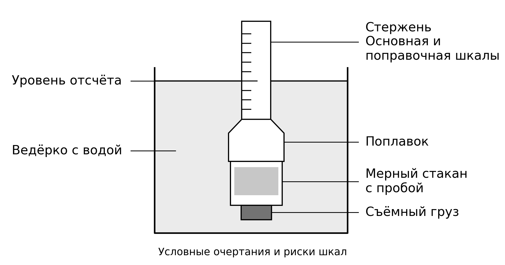

# 1. Теоретические основы определения плотности буровых растворов

## 1.1. Плотность бурового раствора и её технологическое значение

Плотность бурового раствора $\rho$ равна отношению массы пробы $m$ к её объёму $V$.

$$
\rho=\frac{m}{V}.\qquad (1)
$$

В СИ массу выражают в килограммах, объём в кубических метрах, плотность в килограммах на кубический метр. При переводе показаний приборов используют соотношение 1 г/см³ = 1000 кг/м³.

Гидро&shy;статическое давление $\Delta p$ неподвижного столба раствора постоянной плотности определяют по формуле (2).

$$
\Delta p=\rho gH,\qquad (2)
$$

где $\Delta p$ измеряют в паскалях, $g$ - ускорение свободного падения, м/с², $H$ - вертикальная высота столба, м. В наклонной скважине $H$ определяют по разности высотных отметок уровня жидкости и точки расчёта.

Если давление в скважине ниже пластового, в неё могут поступить газ, нефть или вода. При превышении давления начала поглощения раствор уходит в пласт. Верхнюю границу давления также ограничивает возможность гидроразрыва. При циркуляции сопротивление восходящему потоку в кольцевом пространстве увеличивает давление на стенки и забой, поэтому при выборе плотности учитывают режим циркуляции.

## 1.2. Методы и приборы измерения плотности

АБР-1 определяет плотность по глубине погружения. При одинаковом объёме проб и неизменной плотности воды в ведёрке ареометр с более плотной пробой тяжелее. Он вытесняет больше воды и погружается глубже.

Мерный стакан вмещает $(78{,}5\pm1)$ см³ пробы. Заполненный стакан соединяют с поплавком поворотом до упора и обмывают снаружи. Прибор погружают в воду и слегка вращают, чтобы удалить приставшие пузырьки воздуха. Когда ареометр свободно плавает, по уровню воды на основной шкале считывают $\rho_\mathrm{осн}$. Съёмный груз крепится под стаканом (рис. 1). Диапазон измерений с грузом составляет 800-1700 кг/м³, без груза - 1700-2600 кг/м³.

Если для погружения используют минерализованную воду, её плотность влияет на глубину погружения. Для определения поправки стакан заполняют той же водой, опускают прибор в ёмкость и считывают $\Delta\rho_\mathrm{попр}$ по поправочной шкале. К показанию основной шкалы прибавляют поправку с учётом её знака. Обе величины выражают в одних единицах.

$$
\rho=\rho_\mathrm{осн}+\Delta\rho_\mathrm{попр}.
$$

Ареометр проверяют с установленным грузом на дистиллированной воде при температуре $(20\pm5)$ °C. Основная шкала должна показать 1 г/см³.

{width=85%}

Пробой заполняют мерную чашку рычажных весов. Избыток выходит через отверстие в крышке. Чашку очищают снаружи и перемещают рейтер по градуированному рычагу, пока встроенный уровень не покажет равновесие. Плотность считывают у края рейтера. При проверке чашку заполняют пресной водой и ставят рейтер на отметку 1 г/см³. Если рычаг отклоняется от равновесия, регулируют противовес.

Пикнометр представляет собой сосуд известной вместимости $V_\mathrm{пик}$. Для определения плотности взвешивают чистый сухой сосуд и сосуд, заполненный пробой. Пусть $m_\mathrm{пуст}$ и $m_\mathrm{зап}$ - показания весов соответственно.

$$
\rho=\frac{m_\mathrm{зап}-m_\mathrm{пуст}}{V_\mathrm{пик}}.
$$

Для воспроизводимого отсчёта отбирают представительную пробу перемешанного раствора, соблюдают условия калибровки, полностью заполняют мерную посуду и очищают её снаружи. Если часть мерного объёма занята пузырьками газа, отсчёт будет ниже плотности дегазиро&shy;ванного раствора.

## 1.3. Материалы и способы регулирования плотности

Для утяжеления в раствор вводят мелкоизмельчённый твёрдый материал большей плотности. Объём добавки в балансе определяют по плотности частиц, поскольку жидкость заполняет промежутки между ними. При выборе материала учитывают также его химическую инертность, размер частиц и абразивность.

Расчётная плотность искусственного оксида железа Fe₂O₃ составляет 4700 кг/м³. Барит BaSO₄ практически нерастворим в воде, его табличная плотность составляет 4200-4500 кг/м³. В задаче для сравнения используют 4250 кг/м³.

Для снижения плотности к раствору добавляют менее плотную жидкость. В расчёте пресная вода и нефть служат альтернативными разбавителями. Выбор жидкости зависит от состава исходного раствора и требований к свойствам готовой смеси.

Бентонит служит глинистым компонентом водной суспензии. В его составе преобладает монтмориллонит, который при взаимодействии с водой гидратируется и набухает. Бентонит влияет на реологические свойства раствора, способствует выносу шлама и снижает фильтрацию воды в проницаемые породы.

## 1.4. Материальный баланс при изменении состава раствора

При смешивании без потерь складываются массы всех компонентов. Для компонента $i$ масса $m_i$ связана с объёмом $V_i$ и плотностью $\rho_i$ по формуле (1). Во всех трёх расчётах считаем смесь однородной, плотности компонентов постоянными, а объём смеси равным сумме исходных объёмов. Тогда для смеси выполняется баланс (3).

$$
\rho V=\sum_i m_i=\sum_i\rho_i V_i,\qquad V=\sum_i V_i.\qquad (3)
$$

В модели (3) плотность смеси равна среднему плотностей компо&shy;нентов, взвешенному по объёмам. Для двух компонентов разной плотности и положительных объёмов плотность смеси лежит строго между плотностями компонентов. Это условие определяет, достижима ли целевая плотность при выбранной добавке.

При гидратации бентонита часть воды связывается глинистыми частицами и её удельный объём может меняться. Поэтому объём приготовленной суспензии может отличаться от суммы исходных объёмов.

Массовую долю $w_i$ находят по отношению массы компонента к полной массе смеси $m$, а объёмную долю $\varphi_i$ - по отношению объёма компонента к полному объёму смеси $V$.

$$
w_i=\frac{m_i}{m},\qquad \varphi_i=\frac{V_i}{V}.\qquad (4)
$$

Обе доли принимают значения от нуля до единицы и могут выражаться в процентах. При утяжелении и разбавлении исходный раствор входит в баланс как один компонент. Его массу вычисляют по начальной плотности и объёму партии.
