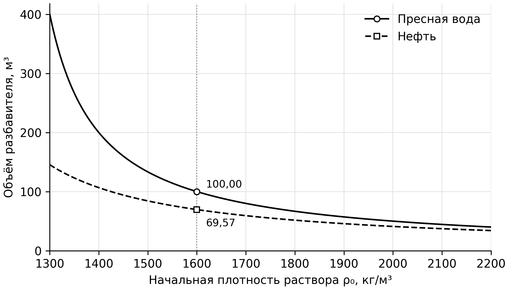

# 3. Анализ полученных результатов

В § 2.1 разность $\rho_\mathrm{у}-\rho_\mathrm{к}$ у искусственного оксида железа Fe₂O₃ больше, чем у барита BaSO₄. Каждый кубометр оксида даёт больший избыток массы над массой равного объёма смеси целевой плотности. Доля этого избытка в массе добавки также выше. Поэтому расчётная масса оксида меньше на 2 191,11 кг (5,46 % от массы барита), а прирост объёма — на 1,37 м³ (14,52 % от прироста с баритом) [1, с. 8, 11 PDF].

В § 2.2 на бентонит приходится 7 % массы и 2,92 % объёма. При равной массе более плотный бентонит занимает меньший объём, чем вода. Объёмная доля рассчитана по плотности сухого материала при аддитивности объёмов. При гидратации глина набухает [1, с. 12, 43 PDF] [2, с. 82–83 PDF].

В условном сценарии § 2.3 нефти требуется на 30,43 % меньше по объёму, чем воды. Менее плотная нефть даёт большую разность $\rho_\mathrm{к}-\rho_\mathrm{д}$. При нулевом исходном нефтесодержании добавленная нефть составляет 25,81 % об. конечной смеси [1, с. 12–13, 40 PDF].

На рисунке 2 обе кривые убывают. При заданном снижении рост начальной плотности увеличивает целевую плотность и её разность с плотностью добавки.

{width=85%}

При приближении сверху к порогам 1200 кг/м³ для воды и 1025 кг/м³ для нефти потребный объём растёт неограниченно. На пороге целевая плотность равна плотности разбавителя и достижима лишь в пределе. Ниже порога требуемое снижение недостижимо [1, с. 12–13 PDF].

Баланс предполагает однородное смешение, постоянные плотности, аддитивность объёмов и сохранение всей исходной партии. При подборе утяжелителя учитывают стоимость и доступность [1, с. 8 PDF], при подборе разбавителя — совместимость с раствором. При постоянной вертикальной высоте столба $H$ снижение плотности уменьшает гидростатический вклад на $gH\Delta\rho$. Для оценки поглощения нужны вертикальная глубина, фактическое давление при циркуляции и давление начала поглощения [1, с. 4–5 PDF] [2, с. 516 PDF].
